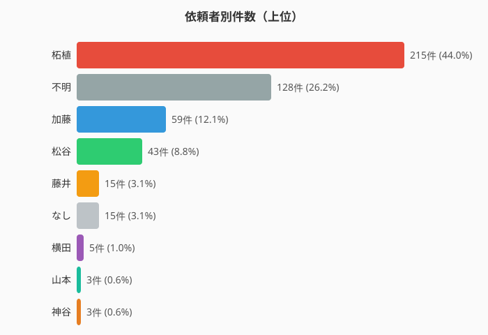
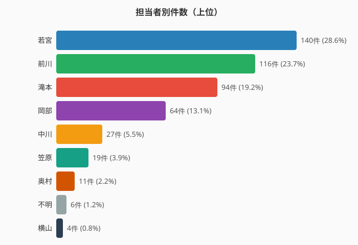

# 検図連絡票 分析結果

西尾工場→技術部 間の検図連絡票（XDWファイル）489件を Claude Vision で分析した結果です。

## 分析概要

| 項目 | 値 |
|------|-----|
| 総件数 | 489件 |
| ZZ番号あり | 264件 (54.0%) |
| ZZ番号なし | 225件 (46.0%) |
| 分析日 | 2026-08-03 |

## カテゴリ分布

| カテゴリ | 件数 | 割合 |
|---------|------|------|
| 質問連絡 | 227 | 46.4% |
| 誤記 | 164 | 33.5% |
| 仕様変更依頼 | 97 | 19.8% |
| その他 | 1 | 0.2% |

## 依頼者別件数（工場側）

| 依頼者 | 件数 | 割合 |
|--------|------|------|
| 柘植 | 215 | 43.9% |
| 不明 | 128 | 26.2% |
| 加藤 | 59 | 12.1% |
| 松谷 | 43 | 8.8% |
| 藤井 | 15 | 3.1% |
| なし | 15 | 3.1% |
| 横田 | 5 | 1.0% |
| 山本 | 3 | 0.6% |
| 神谷 | 3 | 0.6% |

## 担当者別件数（技術部側）

| 担当者 | 件数 | 割合 |
|--------|------|------|
| 若宮 | 140 | 28.6% |
| 前川 | 116 | 23.7% |
| 滝本 | 94 | 19.2% |
| 岡部 | 64 | 13.1% |
| 中川 | 27 | 5.5% |
| 笠原 | 19 | 3.9% |
| 奥村 | 11 | 2.2% |
| 不明 | 6 | 1.2% |
| 横山 | 4 | 0.8% |
| その他 | 8 | 1.6% |

## データファイル

- [`result.tsv`](result.tsv) — 全489件の分析結果（TSV形式）

### result.tsv の列定義

| 列 | 説明 |
|----|------|
| idx | 連番（0000〜0488） |
| filename | 元のXDWファイル名 |
| num_pages | ページ数 |
| category | 誤記 / 質問連絡 / 仕様変更依頼 / その他 |
| zz_num | ZZ-XXXX 形式の番号（なければ「なし」） |
| machine | 機種コード |
| requester | 依頼者（工場側） |
| recipient | 担当者（技術部側） |
| summary | 内容の要約 |

## 分析方法

- ツール: Claude Vision（Read tool）による画像認識
- 入力: XDWファイルをPNGに変換した画像（635枚）
- ZZ番号: ZZ-XXXX 形式のみ対象（S-XXXX, ZK-XXX 等は「なし」）
- 担当者特定: ファイル名「(XXXさん対応中)」を最優先とし、手書き宛名「技術 〇〇様」で補完
